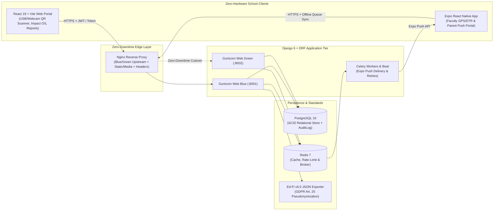

# AttendSure v3.1 — Architecture, Security & Global Compliance Whitepaper

## 1. High-Level System Architecture

---

## 2. Cryptographic & Anti-Spoofing Controls

| Attack Vector | Mitigation Implemented in Code | Source Reference |
|---|---|---|
| **Forged / Cloned Student QR Badges** | HMAC-SHA256 signed QR tokens (`qr_signer.py`); legacy unsigned tokens disabled by default (`ALLOW_LEGACY_UNSIGNED_QR=False`). | `backend/common/qr_signer.py` |
| **Proxy Teacher Clock-In (Buddy Punching)** | Hardware-backed device UUID persisted in `expo-secure-store` & synced with `TeacherProfile.bound_device_id`; missing device IDs rejected once bound; shared-device unique constraint enforced cleanly. | `mobile/src/services/deviceService.ts`, `backend/apps/campus/services.py` |
| **Fake GPS / Coordinate NaN Injection** | Client detects `loc.mocked`, server rejects `is_mock_location=True`, validates `math.isfinite()` coordinates & clamps Haversine domain `[0, 1]`. | `backend/common/gps.py`, `backend/apps/campus/services.py` |
| **Cross-Teacher / Parent IDOR** | Strict section/student scoping across QR cards, enrollments, exit passes, attendance, reports, and parent-teacher chat threads; `PARENT` role explicitly blocked from staff endpoints. | `backend/apps/accounts/selectors.py`, `backend/apps/students/views.py`, `backend/apps/messaging/selectors.py` |
| **Brute-Force & Password Tampering** | 5-attempt lockout with automatic 15-minute expiry reset; password changes require current password verification and immediately revoke existing DRF API tokens. | `backend/apps/accounts/models.py`, `backend/apps/accounts/services.py` |
| **XSS in Interactive Campus Maps** | All dynamic teacher/campus fields HTML-escaped via `escapeHtml()` before rendering inside Leaflet map popups. | `web/src/api/routes.ts`, `web/src/components/tabs/GeofenceTab.tsx` |
| **Demo Endpoint Exposure in Production** | `DemoLoginView` strictly requires `DEBUG=True` or `ENABLE_JUDGE_DEMO=True`, returning `404 Not Found` otherwise. | `backend/apps/accounts/views.py`, `backend/config/settings.py` |

---

## 3. Global Privacy & Regulatory Compliance Matrix

| Framework | Scope | AttendSure Implementation |
|---|---|---|
| **GDPR (EU — Art. 5, 25, 32)** | Data minimization, pseudonymization, security of processing | Optional deterministic SHA-256 pseudonymization (`?anonymize=1`) on Ed-Fi v6.0 exports strips student/staff names and truncates birthdates to year-only; full audit logging on every export. |
| **FERPA (US)** | Protection of student education records | Role-Based Access Control ensures teachers only access enrolled students in their assigned sections; parents only see their own linked children. |
| **COPPA (US)** | Privacy of children under 13 | Zero student-facing tracking apps or third-party ad SDKs; students carry passive printed QR cards with opaque signed tokens containing zero plaintext PII. |
| **RA 10173 (Philippines Data Privacy Act)** | National statutory privacy compliance | Encrypted transport flags (`ENABLE_HTTPS_STRICT`), strict RBAC, non-privileged Docker runtime, IP-validated `AuditLog` accountability trail. |
| **DepEd PH Official Forms** | Statutory school registers & payroll DTR | Native generation of SF1 (School Register), SF2 (Daily Attendance), SF4 (Monthly Learner Movement), and CSC Form 48 (Faculty DTR). |

---

## 4. Ed-Fi Data Standard v6.0 Resource Mapping

Endpoint: `GET /api/v1/reports/edfi-export/?days=30&anonymize=1` (School Leaders only)

| AttendSure Model | Ed-Fi v6.0 JSON Resource | Standard Descriptor / Notes |
|---|---|---|
| `SchoolSettings` | `schools[]` | `schoolId`, `nameOfInstitution`, `localEducationAgency`, `SchoolTypeDescriptor#Regular` |
| `Section` + `GradeLevel` | `sections[]` | `sectionIdentifier`, `gradeLevelDescriptor`, `adviserStaffUniqueId` |
| `Student` | `students[]` | `studentUniqueId` (LRN or `STU-<SHA256>` when anonymized), `SexDescriptor` |
| `Enrollment` | `studentSectionAssociations[]` | `beginDate`, `enrollmentStatus`, `schoolYear`, `isConditionalCashTransferRecipient` |
| `TeacherProfile` | `staffs[]` | `staffUniqueId` (Employee ID or `STF-<SHA256>`), `positionTitle`, `department` |
| `DailyAttendance` | `studentSchoolAttendanceEvents[]` | Maps `PRESENT/LATE/ABSENT/CUTTING/EXCUSED` to official `uri://ed-fi.org/AttendanceEventCategoryDescriptor#*` URIs |
| `ClassAttendance` | `studentSectionAttendanceEvents[]` | Period-level QR/manual attendance with subject code and ISO-8601 timestamp |

---

## 5. Offline-First & Zero-Downtime Reliability

- **Mobile Offline Queue (`mobile/src/services/offlineQueue.ts`):** Persists failed heartbeats and attendance actions (`POST`, `PUT`, `PATCH`) in `AsyncStorage`, deduplicates stale location pings (> 24h), drops permanent 4xx errors (`400`, `403`, `404`, `409`), and retries transient network errors up to 8 times upon reconnection.
- **Blue-Green Deployment (`docker-compose.yml`, `deploy/switch.sh`, `deploy/switch.ps1`):** Alternates live traffic between `web_blue:8001` and `web_green:8002`, runs migrations and `collectstatic`, verifies `HTTP 200` on `/api/health/db/`, and reloads Nginx atomically without dropping active classroom scans.
