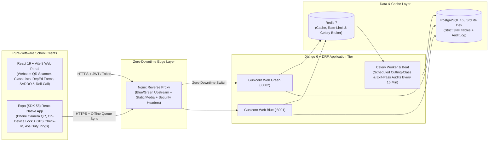

# AttendSure v3 — Architecture, 3NF Data Model & Security Guide

This document describes the live engineering architecture, strict Third Normal Form (3NF) database design, 5-role staff access model, anti-spoofing defenses, and privacy controls implemented in `AttendSure_V3`.

---

## 1. High-Level System Architecture

### Backend Modular Layout (6 Apps + Shared Helpers)

| Module | Path | Responsibility |
|---|---|---|
| **Accounts** | `backend/apps/accounts/` | Staff login/logout, JWT + DRF token auth, 5-strike account lockout, `Department`, `PositionTitle`, `TeacherProfile`, `UserProfile`, `AuditLog`, and environment-gated demo preview login. |
| **School** | `backend/apps/school/` | `SchoolYear`, `AdministrativeDivision`, `SchoolSettings`, `SchoolHoliday`, `Building`, `Room`, `GradeLevel`, `Subject`, `Section`, `ClassPeriod`, shared weekday schedule helpers (`expand_schedule_days`, `period_runs_on_weekday`), and `seed_competition_demo`. |
| **Students** | `backend/apps/students/` | `AddressLocation`, `Student`, `Enrollment`, student directory filtering, CSV bulk import, and signed QR ID card generation. |
| **Attendance** | `backend/apps/attendance/` | Built-in camera QR scanning (`POST /api/v1/attendance/scan/`), batch offline queue sync (`POST /api/v1/attendance/offline-sync/`), manual class list edits, weekday-filtered adviser matrix, weekday-filtered cutting-class detector, and student/teacher exit passes. |
| **Campus** | `backend/apps/campus/` | `CampusBoundary`, teacher check-in/out (`POST /api/v1/campus/check-in/`), live 45-second GPS pings (`POST /api/v1/campus/ping/`), `LoafingIncident` alerts & resolution, `MonthlyTimeRecord` (DTR), Celery beat audit task, and 1-Click Emergency Roll-Call (`GET /api/v1/campus/roll-call/`). |
| **Reports** | `backend/apps/reports/` | Dashboard metrics, print-ready DepEd **SF1**, **SF2**, **SF4**, **CSC Form 48 (DTR)** submission & approval, **30-Day SARDO Risk**, campus safety summary, and **DepEd Division Data Export** (`JSON` / `CSV`). |
| **Common** | `backend/common/` | `permissions.py`, `qr_signer.py`, `gps.py`, `audit.py`, `media.py`, `phone.py`, `pagination.py`, `exceptions.py`, `security.py`, `request_logger.py`, and `fields.py`. |

---

## 2. Strict 3NF Database Design

Every model avoids duplicate text columns and stale derived fields, verified automatically by `Strict3NFDatabaseIntegrityTests` in `backend/apps/accounts/tests.py`:

| Table / Model | 3NF Rule Enforced | Dynamic / Derived Values |
|---|---|---|
| `TeacherProfile` (`teacher_profiles`) | Stores only teacher-specific fields (`employee_id`, `middle_name`, `suffix`, `contact_number`, `can_handle_classes`, `bound_device_id`, `biometric_key_id`) plus normalized FKs to `auth.User`, `Department`, and `PositionTitle`. Never duplicates `first_name`, `last_name`, `email`, or `is_active`, and stores zero raw face photos or biometric templates. | `first_name`, `last_name`, `email`, `full_name`, `is_active`, `department_name`, `position_title` read from joined rows. |
| `UserProfile` (`user_profiles`) | Stores only `role`, `failed_login_attempts`, and `locked_until` linked 1-to-1 to `auth.User`. | `is_locked()`, `is_profile_completed`. |
| `AddressLocation` (`address_locations`) | Normalized lookup table with `UniqueConstraint(barangay, municipality_city, province)` shared across students. | Referenced by `Student.location`. |
| `Student` (`students`) | Stores learner identity (`lrn`, name, `gender`, `birth_date`, `qr_token`), `AddressLocation` FK, and plain-text guardian details for DepEd SF1. Never stores `section` or `grade_level` directly. | `full_name`, `barangay`, `municipality_city`, `province`. |
| `Enrollment` (`enrollments`) | Links `Student` and `Section` with `UniqueConstraint(student, section)`. Never duplicates `school_year` or `grade_level`. | `school_year` and `grade_level` derived from `section`. |
| `ClassPeriod` (`class_periods`) | Links `Section`, `Subject`, and `TeacherProfile` with atomic `day_of_week` (`ALL_WEEKDAYS`, `MWF`, `TTH`, `"1"`–`"7"`), `start_time`, and `end_time`. Never duplicates `school_year` or `grade_level`. | `expand_schedule_days()` and `period_runs_on_weekday()` compute active ISO weekdays (`1`–`7`). |
| `DailyAttendance` (`daily_attendance`) | Links `Enrollment` + `attendance_date` uniquely (`uq_daily_att_enrollment_date`). Zero redundant student, section, or school year columns. | Student, section, and school year resolved through `enrollment`. |
| `ClassAttendance` (`class_attendance`) | Links `Enrollment` + `ClassPeriod` + `attendance_date` uniquely (`uq_class_att_enrollment_period_date`), plus unique `client_scan_uuid` to prevent duplicate offline sync entries. | Student, section, and subject resolved through `enrollment` and `class_period`. |
| `TeacherLocationPing` (`teacher_location_pings`) | Stores raw `latitude`, `longitude`, `accuracy_meters`, `zone_status`, and `recorded_at` linked to `TeacherProfile` and `CampusBoundary`. Never stores derived `distance_meters` or `is_inside` columns. | `distance_meters` and `is_inside` computed dynamically via Haversine distance against `boundary`. |
| `ExitPass` (`exit_passes`) | Enforces database-level `CheckConstraint` (`ck_exitpass_xor_bearer`): every pass must link to **either** a `STUDENT` `enrollment` **or** a `TEACHER`, never both and never neither. Never stores a stale `status` column. | `pass_status` (`ACTIVE`, `RETURNED`, `OVERDUE`, `CANCELLED`) and `is_currently_valid` computed live against current server time. |
| `LoafingIncident` (`loafing_incidents`) | Links to `TeacherProfile`, `Enrollment`, `ClassPeriod`, `ExitPass`, and `TeacherLocationPing`. Never stores copied names, codes, or distances. | `incident_date` and `distance_meters` computed from linked rows. |
| `MonthlyTimeRecord` (`monthly_time_records`) | Unique per `(teacher, month, year)` tracking CSC Form 48 teacher submission (`is_submitted`, `submitted_at`) and Department Head approval (`is_dept_head_approved`, `approved_by`, `dept_head_approved_at`). | Daily time logs joined dynamically from `TeacherDailyAttendance`. |

---

## 3. Synchronized 5-Role Staff Access Model

Access rules are enforced on the server in `backend/common/permissions.py` and mirrored on both clients (`web/src/utils/permissions.ts` and `mobile/src/utils/permissions.ts`). Gate 3 of `scripts/audit_codebase.py` executes 184 automated checks across all five profiles to guarantee they never drift out of sync.

| Capability | `ADMIN` | `PRINCIPAL` | `DEPT_HEAD` | Teaching `TEACHER` (`can_handle_classes=True`) | Non-Teaching `TEACHER` (`can_handle_classes=False`) |
|---|:---:|:---:|:---:|:---:|:---:|
| Dashboard & Own Campus GPS / DTR | Yes | Yes | Yes | Yes | Yes |
| Built-In Camera Student QR Scanner | Yes | Yes | Yes | Assigned Classes | No |
| Class Lists, Adviser Matrix & SF1/SF2 | Yes | Yes | Yes | Assigned Classes | No |
| Add / Edit Students | All Sections | All Sections | Read-Only | Own Advised Section Only | No |
| Delete / Bulk CSV Import Students | Yes | Yes | No | No | No |
| Issue Student Exit Passes | Yes | Yes | Yes | Yes | No |
| Request Own Official Locator Slip | Yes | Yes | Yes | Yes | Yes |
| Approve / Cancel Teacher Locator Slips | Yes | Yes | Yes | No | No |
| Resolve Loafing / Cutting Alerts | Yes | Yes | Yes | No | No |
| View Teacher Directory & DepEd SF4 | Yes | Yes | Yes | No | No |
| Edit Campus GPS Boundary & Reset Bound Phone | Yes | Yes | No | No | No |
| View System Audit Logs | Yes | Yes | No | No | No |
| Academic Setup Tab | Full CRUD | View-Only | No | No | No |
| Manage Staff User Accounts & Teacher Directory CRUD | Yes | No | No | No | No |

Only school staff accounts exist in AttendSure (`ADMIN`, `PRINCIPAL`, `DEPT_HEAD`, `TEACHER`). Attempts to create disallowed external roles are rejected with `HTTP 400`.

---

## 4. Built-In Camera, On-Device Lock & Anti-Spoofing Controls

| Security Risk | Implemented Defense | Code Reference |
|---|---|---|
| **Forged or Unsigned Student QR IDs** | Student QR codes carry an HMAC-SHA256 signature tied to `SECRET_KEY` (`ATTENDSURE:<lrn>|<qr_token>:<sig>`). Raw LRNs, unsigned tokens, and tampered strings are rejected. | `backend/common/qr_signer.py` |
| **Proxy Teacher Clock-In (Buddy Punching)** | Each teacher's phone generates a 1-to-1 device ID stored in `expo-secure-store` (`TeacherProfile.bound_device_id`) plus an on-device check-in secret whose public SHA-256 digest is enrolled on first check-in (`TeacherProfile.biometric_key_id`). Both `bound_device_id` and `biometric_key_id` are verified with `hmac.compare_digest` on every check-in, and duplicate phone bindings are blocked with `HTTP 403`. Only `ADMIN` or `PRINCIPAL` can reset a bound phone. | `mobile/src/services/deviceService.ts`, `mobile/src/services/biometricService.ts`, `backend/apps/campus/services.py` |
| **Biometric Privacy Exposure** | Teacher identity verification runs strictly on the phone via `expo-local-authentication` (Face Unlock, Fingerprint, or PIN/Pattern fallback). Zero raw face photos, fingerprints, or passcodes ever leave the phone or reach the server. | `mobile/src/services/biometricService.ts`, `backend/apps/accounts/models.py` |
| **Fake GPS, Teleportation & Weak Signals** | Mobile blocks `loc.mocked` and accuracy > 250 m before sending. Server independently rejects `is_mock_location=True`, non-finite or `(0, 0)` coordinates, accuracy > 250 m, and implausible travel speed (> 55 m/s), using clamped Haversine math with a max 35 m GPS drift allowance. | `backend/common/gps.py`, `backend/apps/campus/services.py`, `mobile/src/services/telemetryService.ts` |
| **Cross-Section Data Access (IDOR)** | Teachers can only scan, view, edit, or print SF1/SF2 for sections they teach or advise; cross-section attempts return `HTTP 403`. | `backend/apps/accounts/selectors.py`, `backend/apps/attendance/views.py`, `backend/apps/reports/views.py` |
| **Password Brute-Force & Token Reuse** | Login endpoints enforce `10/minute` throttling plus a 5-failed-attempt lockout for 15 minutes (recorded in `AuditLog`). Password changes require the current password and immediately rotate/revoke active API tokens. | `backend/apps/accounts/models.py`, `backend/apps/accounts/services.py` |
| **Malicious File Uploads** | `FlexibleImageField` checks image magic bytes and dimensions via Pillow and enforces a 2 MB file upload limit (`FILE_UPLOAD_MAX_MEMORY_SIZE`). | `backend/common/media.py`, `backend/config/settings.py` |
| **Map & CSV Injection** | Dynamic teacher/campus strings are HTML-escaped before Leaflet map popup rendering, and exported CSV cells are escaped via `_safe_csv_cell()`. | `web/src/components/tabs/GeofenceTab.tsx`, `backend/apps/reports/views.py` |
| **Production Preview Endpoint Lock** | `/api/v1/accounts/demo-login/` returns `HTTP 404` whenever `DEBUG=False` and `ENABLE_JUDGE_DEMO=False`. | `backend/apps/accounts/views.py`, `backend/config/settings.py` |

---

## 5. Philippine Privacy & DepEd Compliance

- **Republic Act 10173 (Philippine Data Privacy Act of 2012):**
  - Strict role-based isolation ensures staff only see records needed for their assigned duties.
  - Zero raw student or teacher biometric templates are collected on the server; students carry passive QR ID cards containing signed opaque tokens rather than exposed personal addresses or contact details.
  - Optional personal ID masking (`?anonymize=1`) is built into **DepEd Division Data Export** (`/api/v1/reports/division-export/`) to protect learner and teacher names when sharing summary data.
  - Every login, lockout, export, record edit, bound-device reset, and loafing resolution writes an accountability record to `AuditLog` with user ID, changed fields, and client IP.
  - Production deployments support strict HTTPS (`ENABLE_HTTPS_STRICT=True` enables HSTS, secure cookies, and SSL redirect), `X-Frame-Options: DENY`, `X-Content-Type-Options: nosniff`, and non-root Docker containers.
- **DepEd Official School Forms & Civil Service Reporting:**
  - **SF1** (School Register), **SF2** (Daily Attendance Report of Learners), **SF4** (Monthly Learner Movement & Attendance), and **CSC Form 48 (DTR)** with submission/approval tracking and print-ready layouts.

---

## 6. Offline Sync, Scheduled Audits & Zero-Downtime Deployment

- **Web Offline QR Queue (`web/src/components/scanner/ClassroomScanner.tsx`):** Queues scanned QR payloads in `localStorage` (`attendsure_offline_qr_queue`) with a unique `client_scan_uuid` when offline and uploads batches via `POST /api/v1/attendance/offline-sync/` when connectivity returns.
- **Mobile Offline Queue (`mobile/src/services/offlineQueue.ts`):** Stores offline student QR scans (`attendsure_offline_qr_scans`) and campus GPS pings (`attendsure_offline_queue`) in `AsyncStorage`. Discards stale GPS pings older than 24 hours, drops permanent `400`/`403`/`404`/`409` responses, pauses on `401`, and retries transient network errors up to 8 times.
- **Weekday-Aware Student Cutting Engine:** `detect_daily_student_cutting` (also exported as `detect_daily_student_loafing`, triggered on demand or every 15 minutes via Celery Beat) evaluates only active `ClassPeriod` rows scheduled on `audit_date.isoweekday()` and skips student cutting alerts cleanly on days with fewer than 2 scheduled periods for a section. Teacher loafing alerts are evaluated separately from live campus GPS boundary pings.
- **Blue-Green Deployment (`docker-compose.yml`, `deploy/switch.sh`, `deploy/switch.ps1`):** Builds and starts the idle upstream (`web_blue:8001` or `web_green:8002`), runs `migrate --noinput` and `collectstatic --noinput`, confirms `HTTP 200` on `/api/health/db/`, swaps `deploy/nginx.conf`, and reloads Nginx without dropping active classroom scans.
